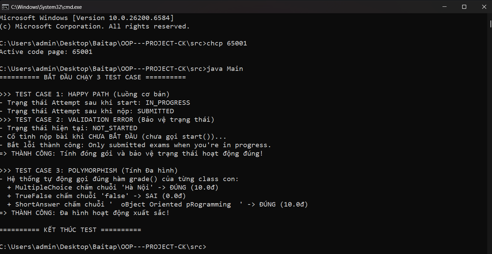
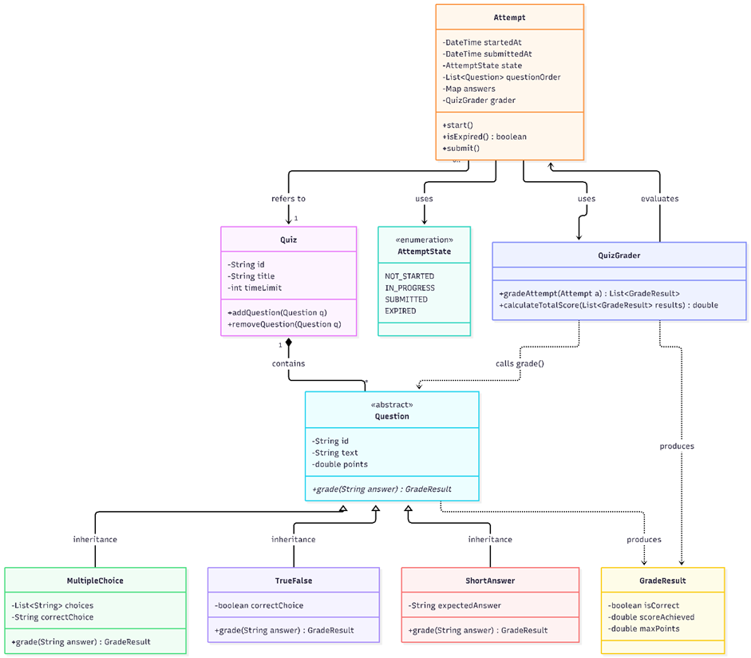

**Week 1:**
In our design, we strategically employed both inheritance and composition to build a flexible system.

Inheritance: We used inheritance for the Question hierarchy (MultipleChoice, TrueFalse, ShortAnswer inheriting from the abstract Question class). This "IS-A" relationship is essential because it allows us to utilize polymorphism. By defining an abstract grade() method in the base class, the QuizGrader can evaluate any question type without needing to know its specific subclass, cleanly satisfying the Open/Closed principle.
Composition: We utilized composition for the relationship between Quiz and Question. A Quiz "has-a" collection of questions. We chose composition over inheritance here because a Quiz is not a type of Question; rather, it acts as a container. This separation of concerns keeps our classes focused on their specific responsibilities.

To successfully implement this project, we will apply the following concepts from our syllabus:

Polymorphism & Abstract Classes: Crucial for implementing the grade() method across different question types without branching logic.
Encapsulation: Necessary for managing the state of an Attempt (ensuring the time limit cannot be tampered with from the outside). This is exactly what I verified in Test Case 2 of our Test Plan
Collections: Required for storing the list of questions within a Quiz and managing the questionOrder within an Attempt.

**Week 2:**

### 1. What Each Class Protects (Encapsulation & Invariants)
In Week 2, I implemented the `Question` hierarchy (`Question`, `MultipleChoice`, `TrueFalse`, `ShortAnswer`), the `GradeResult` class, and the 3 core test scenarios in `Main.java`:
* **Abstract Class `Question`:** Protects the core identity and scoring weight of a question (`private String id`, `private String text`, `private double points`). These fields are encapsulated so that once a question is created in a quiz, external callers cannot arbitrarily alter its point value during an active attempt.
* **Subclasses (`MultipleChoice`, `TrueFalse`, `ShortAnswer`):** Each subclass encapsulates its specific evaluation answer key (`private String correctChoice`, `private boolean correctAnswer`, and `private String expectedAnswer`). Importantly, **no getter methods** (such as `getCorrectChoice()`) are exposed for these answer keys. The only way to interact with the answer key is indirectly through the polymorphic `grade(String studentAnswer)` method.
* **Class `GradeResult`:** Encapsulates the grading outcome (`score`, `maxPoints`, `isCorrect`) so that a question's evaluation result cannot be tampered with after `grade()` returns it.

### 2. What Breaks if Fields Are Made `public`? (Concrete Scenarios)
If the answer fields in the `Question` subclasses or the state fields in `Attempt` were made `public`, two critical vulnerabilities would occur:
1. **Answer Leakage & Cheating (`public String correctChoice`):** 
   * *How it breaks:* If `correctChoice` in `MultipleChoice` were `public`, any external caller or client-side UI script holding a reference to a `Question` object could directly read `q1.correctChoice` without ever solving the problem, or worse, overwrite it (`q1.correctChoice = studentInput`) right before `grade()` is called to guarantee a 100% score.
   * *How our code prevents it:* By keeping `correctChoice` strictly `private` and omitting any getter method for it, the answer key never leaves the object. The caller must pass their guess into `q1.grade(studentAnswer)`, which internally compares `studentAnswer.trim().equalsIgnoreCase(correctChoice.trim())` and only returns a `GradeResult`.
2. **Bypassing Exam Lifecycle (`public Map<String, String> answers` or `public AttemptState state`):**
   * *How it breaks:* If `answers` in `Attempt` were `public`, a student could insert or modify answers (`attempt.answers.put("Q1", "2")`) even when the exam state is `NOT_STARTED` or already `SUBMITTED`.

### 3. Worked Example by Hand (Tracing Polymorphic `grade()` & State Protection)
Below is a hand-trace of how our code executes across **Test Case 1** and **Test Case 3**:

| Step | Code Executed in `Main` | Dynamic Method / Internal Logic Triggered | Object State / Output |
| :--- | :--- | :--- | :--- |
| **1** | `Attempt attempt = new Attempt(..., emptyAnswers);` | Constructor copies map: `this.answers = new HashMap<>(answers);` | `state = NOT_STARTED`, `answers = {}` |
| **2** | `attempt.start();` | Checks `state == NOT_STARTED`, sets `startedAt = now()` | `state = IN_PROGRESS` |
| **3** | `attempt.answerQuestion("Q1", "2");` | Checks `state == IN_PROGRESS`, executes `this.answers.put("Q1", "2")` | `answers = {"Q1": "2"}` |
| **4** | `q1.grade("Hà Nội")` *(Runtime type: `MultipleChoice`)* | Calls `MultipleChoice.grade()`: `"Hà Nội".trim().equalsIgnoreCase("Hà Nội")` | `isCorrect = true`, returns `GradeResult(10.0, 10.0, true)` |
| **5** | `q2.grade("false")` *(Runtime type: `TrueFalse`)* | Calls `TrueFalse.grade()`: compares parsed boolean `false == true` | `isCorrect = false`, returns `GradeResult(0.0, 10.0, false)` |
| **6** | `q3.grade("  oBject Oriented pRogramming  ")` *(Runtime type: `ShortAnswer`)* | Calls `ShortAnswer.grade()`: `.trim().equalsIgnoreCase("Object Oriented Programming")` | `isCorrect = true`, returns `GradeResult(10.0, 10.0, true)` |

*(Note on `ShortAnswer` design: I chose the **exact match with case-insensitivity and whitespace trimming** approach using `.trim().equalsIgnoreCase(...)`. This prevents students from losing points due to accidental leading/trailing spaces or capitalization differences while keeping auto-grading deterministic.)*

### 4. Where AI-Generated Design Needed Modification (Critical Use of AI)
During Week 2 integration testing, we encountered a real bug caused by a mismatch between an AI-suggested test flow and Kha's defensive encapsulation in `Attempt.java`:
* **The Issue:** Initially, in `Main.java` (Test Case 1), AI suggested populating student answers using `attempt.getAnswers().put("Q1", "2")`. When we ran the test, it crashed with: `Cannot invoke "String.trim()" because "<parameter1>" is null`.
* **How We Found Out & Diagnosed It:** By tracing the data flow into `Attempt.java`, we realized Kha had implemented **Defensive Copying** in `getAnswers()` (`return new HashMap<>(answers);`). Therefore, `.getAnswers().put(...)` only modified a temporary shallow copy, leaving the internal `this.answers` map empty (`null` values for every question ID when graded). Furthermore, another AI suggestion to pre-fill the `Map` before calling ` new Attempt(...)` violated real-world domain logic (answering questions before starting the timer).
* **How We Fixed It:** Instead of weakening encapsulation by returning the raw `Map` reference, we added a controlled mutator method `answerQuestion(String questionId, String answer)` in `Attempt.java`. This method enforces the state invariant (`if (this.state != AttemptState.IN_PROGRESS) throw new IllegalStateException(...)`) before inserting into `this.answers`.

### 5. Test Output Evidence
All 3 required scenarios (Happy Path, Validation/Error State Protection, and Polymorphism without `if/else`) compiled and passed:


**Week 3:**

### 1. Refactoring & Custom Exceptions (Before/After)
Previously, handling invalid submissions relied on generic exceptions or returning `false` via procedural `if/else` statements. I refactored this approach by implementing **Custom Exceptions** (`QuizNotStartedException` and `AttemptExpiredException`) to handle business logic edge cases explicitly.

**[BEFORE] Procedural Code (Generic Exceptions):**
```java
// Inside Attempt.java
public void submit(int timeLimitMinutes) {
    if (this.state == AttemptState.NOT_STARTED) {
        throw new IllegalStateException("Quiz not started!"); 
    }
    if (isExpired(timeLimitMinutes)) {
        this.state = AttemptState.EXPIRED;
        throw new IllegalStateException("Time is up!");
    }
    this.state = AttemptState.SUBMITTED;
    this.submittedAt = LocalDateTime.now();
}
```

**[AFTER] Refactored Code (OOP Custom Exceptions):**
```java
// Inside Attempt.java
public void submit(int timeLimit) throws QuizNotStartedException, AttemptExpiredException {
    if (state != AttemptState.IN_PROGRESS) {
        throw new QuizNotStartedException("Only submitted exams when you're in progress.");
    }
    if (isExpired(timeLimit)) {
        this.state = AttemptState.EXPIRED;
        throw new AttemptExpiredException("Bài thi đã quá thời hạn quy định, tự động chuyển sang EXPIRED");
    }
    else {
        this.submittedAt = LocalDateTime.now();   //đánh dấu thời gian nộp bài
        this.state = AttemptState.SUBMITTED;      //đánh dấu bài thi đã nộp
    }
}
```

### 2. OOP Principle Applied: Encapsulation
This refactoring directly improves and demonstrates **Encapsulation**. 
- **Why this is the right tool for the problem:** The `Attempt` class must be solely responsible for tracking its own timing and submission state. By introducing specialized custom exceptions, `Attempt` strictly protects its internal state lifecycle. Any external caller invoking `submit()` is now forced by the compiler to handle (via try-catch) these specific business rules. This perfectly encapsulates the error-handling logic within `Attempt`, preventing external components from blindly overriding the state or bypassing time limits.

### 3. Edge-Case Testing & Reflection (Verification)
To verify this encapsulation (specifically boundary values for timing), I implemented **Test Case 2.2**. 
- Because waiting 60 minutes during a unit test is unfeasible, I utilized **Reflection** (`getDeclaredField("startedAt")`) to securely access the `private` started time and rewind it by 65 minutes. 
- When `submit(60)` was subsequently called, the system successfully caught the edge case and threw the `AttemptExpiredException`, proving that the time-limit constraint is strictly enforced server-side.

### 4. Artifacts & Deliverables
- **Updated UML:** Revised `UML.png` to accurately reflect the new Custom Exceptions (`QuizNotStartedException`, `AttemptExpiredException`) and the new interactive methods (`answerQuestion`, `printScoreBreakdown`).
  - 
- **Test Output:** Full verification of edge cases (Test 2.1 & 2.2) and the interactive threaded test (Full Completed Test) is documented in the test artifacts.
  - [View Test Output Log](./docs/test_output_week3.txt)
